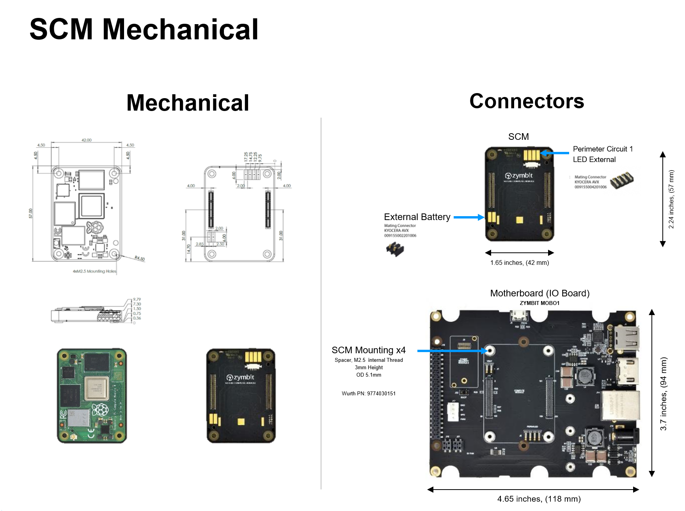
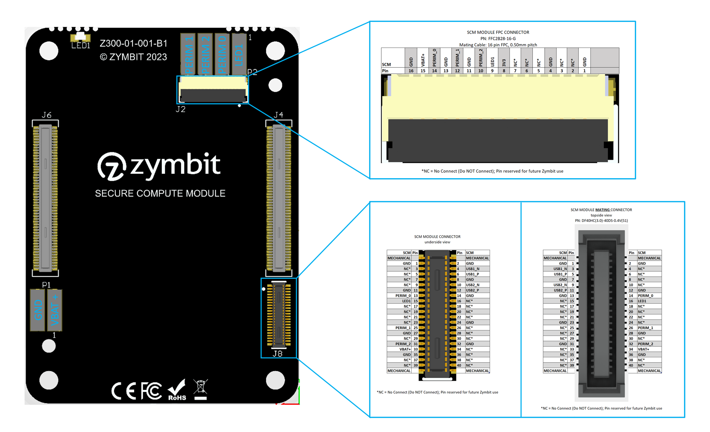

## 3D Step Model

[SCM 3D model](https://github.com/Zymbit-Docs/docs/releases/download/cad-files/ZYMBIT-SCM-CAD-Model-defeatured-no-battery-2022.12.step) (11 MB)

## 2D Drawing

## SCM Rev B1 Mechanical/Connectors

